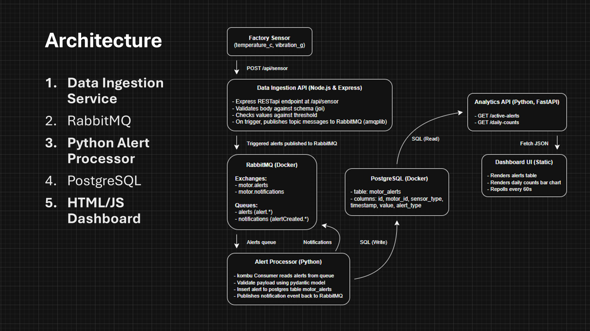

# Factory Motor Health Monitoring

A tiny pipeline for factory motor monitoring with RabbitMQ.



## Services
```bash
# Start RabbitMQ + PostgreSQL with Docker
make setup 
```

`01_data_ingestion/`
```bash
# Install dependencies
make setup1

# Run API (http://localhost:3000)
make 1
```

`02_alert_processing/`
```bash
# Install dependencies
make setup2

# Run processor
make 2
```

`04_frontend_prototype/`

```bash
# Install dependencies
make setup4

# Run API (http://localhost:8000)
make app4

# View the dashboard at
# 04_frontend_prototype/index.html
```

`tests/`
```bash
# Send sample data
pytest
```